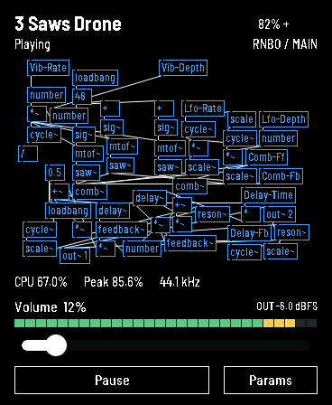
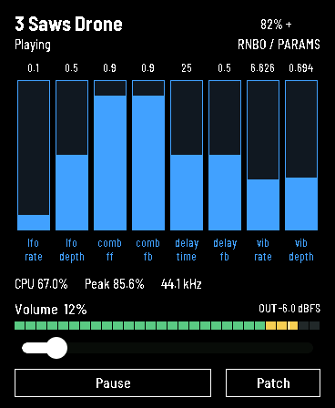

# AMOLED controls

> **Current intake:** create C++ with Max’s [Minimal Export](native-export.md), then compile/package it in Studio. `.rnbopat` is drawing data only. Hardware interfaces below are retained; earlier patch/compiler measurements apply only to their recorded builds.

The 368×448 AMOLED interface keeps the FM1-style patch drawing and adds a
dedicated parameter page. The bottom row has one wide playback button and
**Params**. The playback button shows **Pause** while playing and **Resume**
while paused; its action follows the audio owner's reported state. A pending
Resume request does not change the caption until playback actually starts.
On the parameter page, **Params** becomes **Patch** to return.
Tapping a blue parameter box in the drawing also opens its parameter page.

All eight drone parameters have wide, filled vertical bars and live values,
like a Max multislider. Touch anywhere in a bar to set its value. Keep the
finger down and move across neighbouring bars to edit several parameters in
one gesture; fast sweeps interpolate skipped columns. Moving vertically changes
the current bar, and a stationary hold does not flood the control queue. Labels
remain below the bars. Patches with more than eight parameters have banks of
eight, selected using the arrows above the bars.

The thicker master volume slider stays available on both pages. Parameters use the existing normalized
control path, so declared ranges, exponent mapping and control-queue guards
remain in force. Parameters are disabled while paused; Resume enables editing.
Pause is the display name for the existing safe mute/reconstruction action;
the USB `panic` command and recovery protocol remain compatible.

The segmented output meter reads the final signed-16-bit speaker buffer,
**after** the volume ramp, mono mix, fixed headroom, saturation and quantization.
Its display updates every 50 ms, with a one-second peak hold and a falling bar.
The scale is −60 to 0 dBFS; nonzero signals below the scale show `<-60`, while
silence shows `-inf`. Logarithms and drawing run on the display side. The audio
task only takes an integer peak over the already-rendered PCM block and
publishes the maximum since the last display update. Battery polling and the
CPU caption retain their one-second cadence.

These are software-rendered previews using the actual LVGL implementation and
fonts, with example telemetry; they are not photographs of the board.

| Patch page | Parameter page |
|---|---|
|  |  |

## Verification

The native LVGL test uses real pointer hit testing for the single playback
button and page button, verifies caption/action agreement through normal,
pending and fault states, and checks
one uninterrupted press across all eight bars, with display updates interleaved
while the finger stays down. It also verifies fast-sweep interpolation, vertical
motion, stationary deduplication, separate volume control, navigation, disabled controls while paused, meter segmentation and
release, and the distinction between low-level signals and silence. The
portable PCM test checks post-volume scaling, gain-ramp settling, immediate
mute, mono cancellation, stereo peaks, clipping and nonfinite handling.

The installed firmware passed device captures at volume zero, five percent,
and zero again. Captured PCM and meter telemetry are silent at zero and
nonzero at five percent. The eight parameter values, volume and Pause state
were restored after installation. No audio-task heap allocations, render
deadline overruns, module, DMA or write errors were observed in this check.
This short check does not replace the longer instrument stress tests.
On the preceding wide-bar build, the user confirmed on the board that a
continuous cross-bar drag works and is easier to control. That gesture code
is retained; this earlier physical check is separate from the new native
button tests and installation checks.

See the [GUI evidence](../evidence/amoled-gui-v4.json) for source/build identities,
native test records, captures and the verified installation result.
